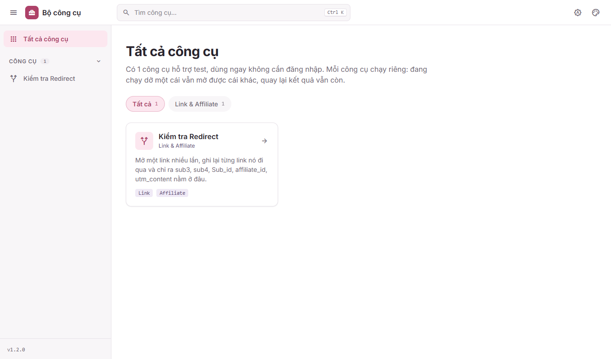
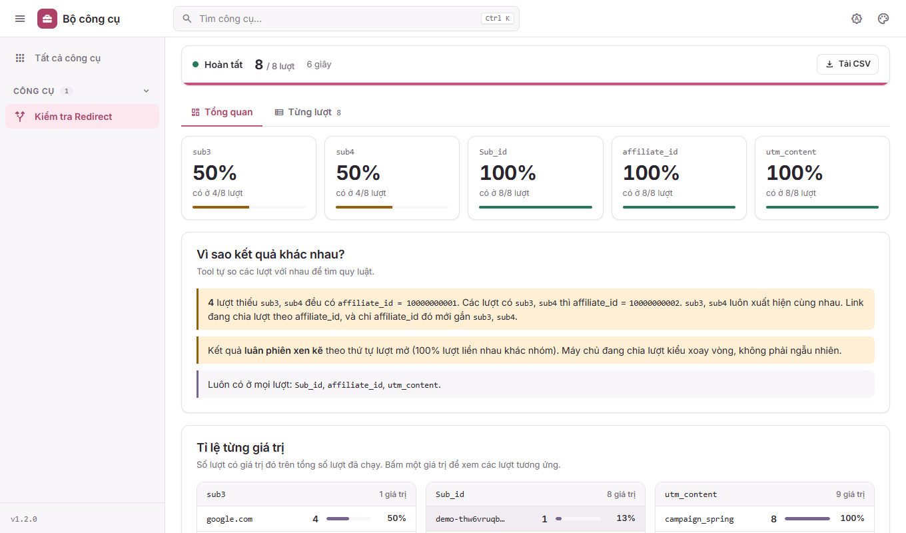
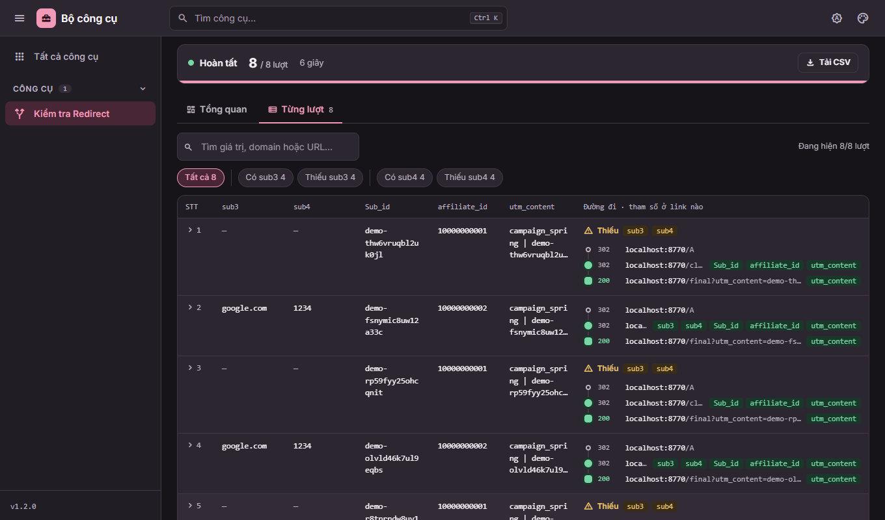
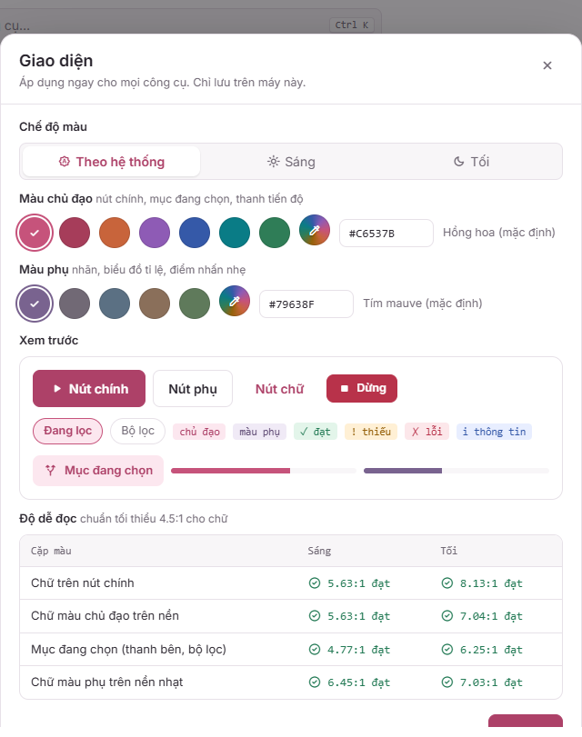

<div align="center">


# Bộ công cụ

**Kho công cụ hỗ trợ test, gói gọn trong một Chrome extension.**
Cài một lần, không cần Node hay máy chủ, gửi file là cả team dùng được.

[Tải bản mới nhất](../../releases/latest) · [Hướng dẫn sử dụng](extension/README.md) · [Báo lỗi](../../issues/new/choose) · [Nhật ký thay đổi](CHANGELOG.md)

</div>



## Công cụ hiện có

| Công cụ | Làm gì |
|---|---|
| **Kiểm tra Redirect** | Mở một link nhiều lần, ghi lại **từng link nó đi qua** (302, JavaScript, meta refresh, mở app) và chỉ ra `sub3`, `sub4`, `Sub_id`, `affiliate_id`, `utm_content` nằm ở link nào. Tự thống kê tỉ lệ từng giá trị và giải thích vì sao các lượt cho kết quả khác nhau. |

Các công cụ tiếp theo sẽ được thêm dần vào cùng extension.

<table>
  <tr>
    <td></td>
    <td></td>
  </tr>
  <tr>
    <td align="center"><sub>Tổng quan: tỉ lệ, nhận xét tự động, các nhóm kết quả</sub></td>
    <td align="center"><sub>Từng lượt: đường đi và vị trí tham số ở mỗi link</sub></td>
  </tr>
</table>

## Cài đặt

1. Vào [Releases](../../releases/latest), tải file `bo-cong-cu-vX.Y.Z.zip` rồi giải nén.
2. Mở Chrome (hoặc Edge, Cốc Cốc) → `chrome://extensions`.
3. Bật **Developer mode** ở góc trên bên phải.
4. Bấm **Load unpacked**, chọn thư mục vừa giải nén.
5. Ghim icon **Bộ công cụ** lên thanh công cụ.

Cập nhật bản mới: giải nén đè vào thư mục cũ, rồi bấm nút tải lại ⟳ của extension trong `chrome://extensions`.

## Tính năng chung

- **Nhiều công cụ trong một chỗ:** tìm công cụ (Ctrl K), lọc theo nhóm, thanh bên chọn nhanh. Công cụ đang chạy dở vẫn chạy khi chuyển sang công cụ khác.
- **Giao diện sáng / tối / theo hệ thống** và **tự chọn màu chủ đạo, màu phụ**. Màu quá nhạt được tự chỉnh để chữ luôn đạt độ tương phản 4.5:1.
- **Xuất CSV** kết quả để mở bằng Excel hoặc Google Sheets.



## Bản chạy bằng Node (tuỳ chọn)

Có thêm bản web (giao diện giống hệt extension, mở tại `http://localhost:3000`) và bản dòng lệnh, chạy bằng trình duyệt ngầm (Playwright). Mỗi lượt là một phiên mới với cookie sạch.

```bash
npm run setup                       # cài thư viện + trình duyệt Chromium (lần đầu)
npm run ui                          # bộ công cụ bản web tại http://localhost:3000
npm start -- "https://link..." --repeat 100   # chạy trong terminal, in bảng kết quả
```

Ngoài ra có [`extras/console-script.js`](extras/console-script.js) để dán vào Console. Script này chỉ đọc được link của trang cùng domain với tab đang mở, nên không thấy các bước 302 ở giữa.

## Phát triển

Yêu cầu: Node.js 20 trở lên (khuyên dùng bản trong [`.nvmrc`](.nvmrc)).

```bash
npm install
npm run verify        # ESLint + kiểm tra cấu trúc extension
npm run ext:zip       # đóng gói extension vào dist/
```

| Lệnh | Tác dụng |
|---|---|
| `npm run lint` / `lint:fix` | Kiểm tra / tự sửa code bằng ESLint |
| `npm run check` | Phiên bản khớp nhau, tool đủ file, HTML hợp lệ với Manifest V3 |
| `npm run ext:zip` | Tạo `dist/bo-cong-cu-v<phiên bản>.zip` |
| `npm run ui` · `npm start` · `npm run detail` | Bản web · dòng lệnh · xem chi tiết 1 lượt |

```
extension/            Chrome extension (sản phẩm chính)
  hub.*               khung bộ công cụ: đầu trang + tìm kiếm, thanh bên, danh mục, cài đặt giao diện
  shared/             theme.css (hệ màu + thành phần) · theme.js (sáng/tối, màu tự chọn)
  tools/registry.js   danh sách công cụ
  tools/_template/    khung để tạo công cụ mới
  tools/redirect/     Kiểm tra Redirect
node/                 bản web (server.js, phục vụ nguyên extension/) và dòng lệnh (trace.js) chạy bằng Playwright
scripts/              đóng gói, kiểm tra, đồng bộ phiên bản
extras/               script dán vào Console
docs/images/          ảnh chụp cho README
```

Muốn thêm công cụ mới, xem [CONTRIBUTING.md](CONTRIBUTING.md).

### Phát hành phiên bản mới

```bash
npm version minor          # tăng phiên bản ở package.json + manifest.json, tạo commit và tag
git push --follow-tags     # GitHub Actions kiểm tra, đóng gói và tạo Release kèm file .zip
```

## Sử dụng có trách nhiệm

Kiểm tra Redirect mở link thật. Mở link affiliate với số lượng lớn có thể bị nền tảng tính là click ảo, hoặc vi phạm điều khoản của họ. Chỉ kiểm tra link bạn có quyền kiểm tra, với số lượt vừa đủ để thấy quy luật. Đừng đưa link hay kết quả chứa dữ liệu thật lên repo công khai; thư mục `results/` đã được loại khỏi git.

## Giấy phép

[MIT](LICENSE) © 2026 [vietvd13](https://github.com/vietvd13)
